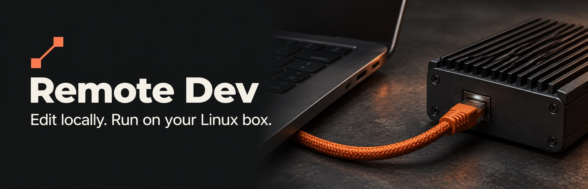
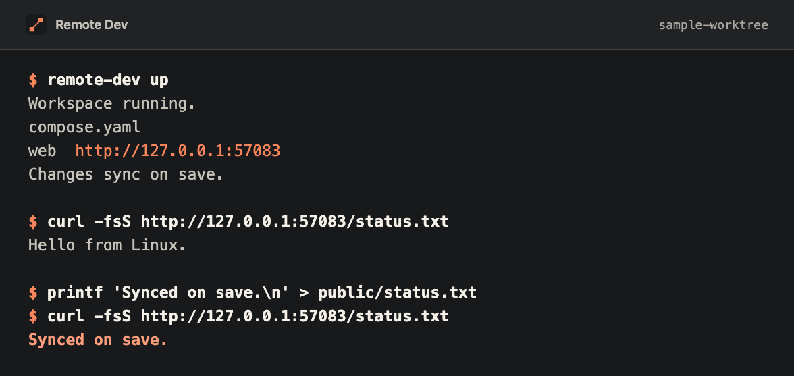

# Remote Dev

Keep your editor, Git worktrees, and browser on your laptop. Run your dev servers and tests on a Linux machine you control. Open your preview on `localhost` and watch test output in your terminal over SSH.

[Quick start](#quick-start) · [Supported projects](#supported-projects) · [User guide](docs/guide.md) · [Contributing](CONTRIBUTING.md)

[](https://github.com/Ross-cripto/remote-dev/actions/workflows/ci.yml) [](LICENSE)

## Quick start

- **On your laptop** · macOS or Linux, Git, and OpenSSH.
- **On your server** · Linux (amd64 or arm64), SSH access, Docker Engine, and Compose v2 available to your SSH account.

**1. Install** the [Go release candidate](https://github.com/Ross-cripto/remote-dev/releases) for macOS or Linux. See the [installation guide](docs/guide.md#install-a-release) for platform names and checksum verification.

**2. Connect** using an SSH alias you already have, or pass `user@server`. Remote Dev installs its bundled Linux helper in your SSH user's data directory.

```sh
remote-dev connect devbox
```

**3. Start** from your project's Git worktree.

```sh
remote-dev up
```

Open the printed URL and edit a file in your local editor. The preview keeps the same URL while edits sync. Run `remote-dev` for the workspace panel, or `remote-dev stop` when you're done.

**Run tests from the same worktree** with `remote-dev test`. Remote Dev takes a snapshot of your saved changes, streams the output from Linux, and returns the test process's exit code. It can use a Compose test service or a Node project's root `test` script. [Remote test guide](docs/guide.md#run-tests-on-linux)

New to Remote Dev? [Try the runnable example](docs/guide.md#try-the-compose-demo). If your server is missing a dependency, see [server setup](docs/guide.md#connect-and-check-a-server).

Upgrading from the Python beta or Go preview? [Migrate an existing worktree](docs/migration.md).

## One preview per worktree



<details>
<summary>Read the terminal transcript</summary>

```text
$ remote-dev up
Workspace running.
compose.yaml
web  http://127.0.0.1:57083
Changes sync on save.

$ curl -fsS http://127.0.0.1:57083/status.txt
Hello from Linux.

$ printf 'Synced on save.\n' > public/status.txt
$ curl -fsS http://127.0.0.1:57083/status.txt
Synced on save.
```

</details>

- **Start from the project you already have.** Remote Dev reads your Compose file or Node development scripts and reports what it found.
- **Use your usual browser.** SSH forwards each preview to your laptop. Frameworks with hot reload, such as Vite, can update the open page.
- **Run branches side by side.** Each worktree has its own Compose project and forwarded ports. Stopping one leaves the others running.

## Supported projects

| What you have | How Remote Dev starts it |
| --- | --- |
| Docker Compose | Detects a root Compose file and supported development overrides or profiles. |
| Node.js | Recognizes common Vite, Next.js, and NestJS development scripts and supported npm, pnpm, and Yarn project layouts. |
| Node.js and Compose infrastructure | Runs a recognized Node app alongside a simple Compose stack, such as Redis on the default network. |
| Custom start commands | Uses an explicit [`remote-dev.toml` configuration](docs/guide.md#configure-a-project-explicitly). |

**Beta.** Remote Dev is intended for trusted development projects on a server you control. After the initial snapshot, saved changes normally transfer as deltas. Some edits restart or rebuild a service. See [how sync works and what it copies](docs/guide.md#source-and-sync).

## Get involved

Try it on a worktree and tell us where detection or setup fell short. Include your project shape and the relevant output so we can reproduce it.

[Report an issue](https://github.com/Ross-cripto/remote-dev/issues/new/choose) · [Report a security issue privately](SECURITY.md) · [MIT license](LICENSE)
